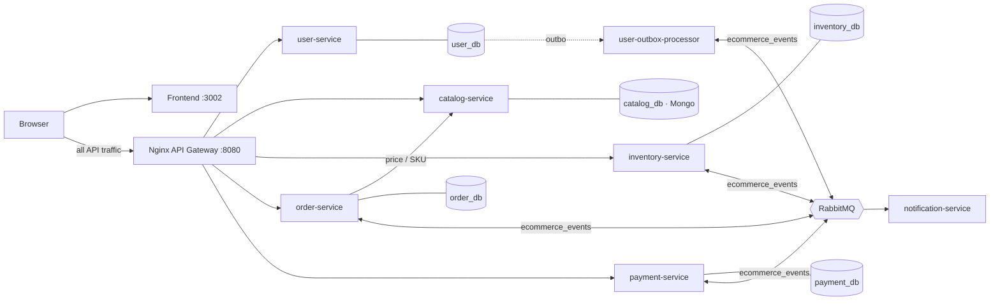

# MicroStore — an event-driven microservices case study

**English** | [Português](./README.pt-BR.md)

[](https://github.com/luxuz24/meu-ecommerce-distribuido/actions/workflows/ci.yml)
[](./LICENSE)


An e-commerce platform split into **five microservices, each with its own database**, that
completes a purchase through a **choreographed Saga** over RabbitMQ — no chained HTTP calls
and no distributed transactions.

The goal is to show, running and tested, how to solve the problems that appear when a
monolith becomes a distributed system:

- writing to the database **and** publishing an event without losing either;
- handling duplicate messages;
- undoing a reservation when payment fails, or when a step never answers;
- preventing two simultaneous orders from selling the same unit;
- following a single purchase across four services.

Each of these guarantees is covered by an end-to-end or chaos test that runs in CI
against the real stack. The defects found along the way are documented in
[Engineering notes](./docs/engineering-notes.md).

---

## Architecture



| Service | Database | Responsibility | Role in the Saga |
|---|---|---|---|
| **user-service** | PostgreSQL `user_db` | Sign-up, JWT login (HS256), RBAC `CUSTOMER` / `ADMIN` | — |
| **catalog-service** | MongoDB `catalog_db` | Storefront, text search, admin CRUD | Source of truth for prices |
| **order-service** | PostgreSQL `order_db` | Order lifecycle `PENDING → STOCK_RESERVED → PAID / CANCELLED` | Starts the Saga and applies its outcome |
| **inventory-service** | PostgreSQL `inventory_db` | Atomic reservation, release, final deduction, expiry | Participant + compensation |
| **payment-service** | PostgreSQL `payment_db` | Simulated charge with an anti-fraud rule | Participant |
| **notification-service** | — | Consumes events and simulates e-mails | Observer |

Only the **gateway (`:8080`)** and the **frontend (`:3002`)** are published on the host.
Services are reachable exclusively through the internal network, so rate limiting, routing
and tracing cannot be bypassed.

## The checkout Saga

1. **`order-service`** receives `{productId, quantity}`, fetches price, name and SKU from the
   catalog, and stores the `PENDING` order and the `ORDER_CREATED` event in the **outbox**,
   in the same transaction.
2. **`inventory-service`** reserves stock with a conditional `UPDATE` and publishes
   `STOCK_RESERVED`. If stock is short it publishes `STOCK_REJECTED` and the order is
   cancelled with no charge.
3. **`payment-service`** charges the server-calculated total and publishes
   `PAYMENT_APPROVED` or `PAYMENT_FAILED`.
4. **Outcome:**
   - **approved:** the order becomes `PAID` and the reservation becomes a final deduction
     (`ORDER_CONFIRMED`);
   - **declined:** the order becomes `CANCELLED` and inventory **releases the reservation**
     (compensation);
   - **no answer:** the reservation **expires** after `RESERVATION_TTL_SECONDS`, the stock
     returns and the order is cancelled.

The full sequence diagram is in [docs/01](./docs/01-visao-e-arquitetura.md#a-saga-de-checkout).

## Guarantees and how they are achieved

| Problem | Solution | Proof |
|---|---|---|
| Write and publish atomically | **Transactional Outbox**; the relay marks `published` only after the broker's *publisher confirm* | Chaos test (broker stopped mid-flow) |
| Duplicate messages (*at-least-once*) | `processed_messages` table + conditional state transitions | Unit + E2E |
| Two orders competing for the same item | `UPDATE … WHERE available_qty >= qty` + `CHECK (available_qty >= 0)` | E2E: 12 simultaneous orders for 4 units → exactly 4 paid |
| Failure in the middle of the Saga | Compensation: `payment_failed` releases the reservation | E2E |
| A step that never answers | Reservation expiry with a conditional sweeper | Chaos test in CI |
| Lost confirmation of a paid order | Expiry of a `PAID` order replays `ORDER_CONFIRMED`; inventory re-acquires the stock | Chaos test in CI |
| Client tampering with prices | Prices resolved in `catalog-service`; client values are discarded | Unit + E2E |
| Broker outage | Reconnection with backoff (1 s → 30 s), topology re-declared, `/health` returns `503` while degraded | Chaos test |
| Poison messages | Dead-letter exchange + one `*_dlq` per queue | — |
| Tracing one purchase across services | `X-Correlation-ID`: gateway → outbox → AMQP property → `AsyncLocalStorage` | E2E + log `grep` |
| Privilege escalation | Public sign-up always creates `CUSTOMER`; admin is provisioned by the server | E2E |

Trade-offs (choreography vs. orchestration, polling outbox vs. CDC, and others) and known
limitations are in [docs/01](./docs/01-visao-e-arquitetura.md#decisões-arquiteturais-adrs-resumidos).

---

## Running locally

Requirements: **Docker** with Compose v2 and **Node.js 24+** (for the seed and test scripts).

```bash
git clone https://github.com/luxuz24/meu-ecommerce-distribuido.git
cd meu-ecommerce-distribuido
cp .env.example .env

docker compose up -d --build --wait   # starts 12 containers and waits for every healthcheck
npm run seed:demo                     # admin, customer and 5 products with stock
```

| | URL | Credentials |
|---|---|---|
| Store | http://localhost:3002 | `cliente@microstore.com` / `ClientePassword123!` |
| Admin panel | http://localhost:3002/admin/products | `admin@microstore.com` / `AdminPassword123!` |
| Interactive architecture page | http://localhost:3002/architecture | — |
| API Gateway | http://localhost:8080 | — |
| RabbitMQ Management | http://localhost:15672 | `guest` / `guest` |

## Demo script

**1. Happy path.** Add a product to the cart and check out. The order starts as `PENDING`
and the page follows it on its own until `PAID`, in about 3 seconds.

**2. Compensation.** Check out again with **"Simular Falha de Pagamento"** (simulate payment
failure) ticked. The order ends `CANCELLED` and stock returns to its original value.

**3. Tracing.** Every response carries an `X-Correlation-ID`, shown in the Dev-mode
telemetry inspector. Use it to follow the purchase across services:

```bash
docker compose logs -t | grep <correlation-id>
```

```
order-service         POST /api/orders
inventory-service     [inventory-service] cid=… <- order_created
payment-service       [payment-service]   cid=… <- stock_reserved
order-service         [order-service]     cid=… <- payment_failed
inventory-service     [inventory-service] cid=… <- payment_failed   (release)
notification-service  Correlation: cid=…
```

**4. Chaos: stop the broker mid-flow.**

```bash
docker stop ecom_rabbitmq
```

Place an order: it is accepted (`201 PENDING`) and the event waits in the outbox.
`/health/order` answers `503` with `"messaging":"disconnected"`.

```bash
docker start ecom_rabbitmq
```

Within seconds all five services reconnect on their own and the order placed during the
outage completes as `PAID`, without losing any event.

**5. Chaos: a step that never answers.**

```bash
RESERVATION_TTL_SECONDS=15 RESERVATION_SWEEP_INTERVAL_MS=2000 docker compose up -d --wait inventory-service
npm run test:chaos
```

The first script makes `payment-service`'s database fail so the payment message is
dead-lettered: the reservation expires, stock returns and the order ends
`CANCELLED (RESERVATION_EXPIRED)`. The second simulates a paid order whose confirmation
was lost: the reservation expires, but the order stays `PAID` and its units stay sold.

---

## Quality gates

```bash
npm run lint        # ESLint + typescript-eslint over services, frontend and scripts
npm test            # 144 unit tests (Vitest, in-memory fakes) across services + frontend
npm run test:e2e    # 9 end-to-end scenarios against the running stack
npm run test:chaos  # two chaos tests: stuck reservation and lost confirmation (need a short TTL)
npm run test:mutation --prefix services/payment-service   # mutation testing (Stryker)
```

End-to-end scenarios ([`scripts/e2e-saga.ts`](./scripts/e2e-saga.ts)) go only through the
gateway and create their own data, so they can run repeatedly:

| Scenario | Verifies |
|---|---|
| Happy path | `PAID`, amount charged = server total, reservation turned into a final deduction |
| Compensation | Declined payment → `CANCELLED` and stock fully released |
| Out of stock | `STOCK_REJECTED` → `CANCELLED`, no charge created |
| Anti-fraud | Purchase above R$ 50,000 declined |
| Price integrity | Price, name and SKU sent by the client are ignored |
| Concurrency | 12 simultaneous orders for 4 units → exactly 4 paid, final stock 0 |
| Duplicate SKU | 8 simultaneous product creations → 1 created, 7 `409 Conflict` |
| Tracing | Client `X-Correlation-ID` preserved by the gateway |
| Security | `role: ADMIN` sign-up becomes `CUSTOMER`; customers cannot force the Saga or call internal endpoints |

**CI** (GitHub Actions) runs on every pull request:
1. lint;
2. build, unit tests and `npm audit` (high/critical fail the build) for each service and the frontend;
3. the full stack from scratch, then the seed, the E2E suite and the chaos test, attaching
   container logs on failure.

## Documentation

| Document | Contents |
|---|---|
| [Engineering notes](./docs/engineering-notes.md) | Defects found, how they were reproduced, fixed and proven |
| [Architecture](./docs/01-visao-e-arquitetura.md) | Saga sequence, guarantees, ADRs, limitations (Portuguese) |
| [API and event contracts](./docs/04-contratos-api-e-eventos.md) | Endpoints, authorization, events and payloads (Portuguese) |
| [Code conventions](./docs/03-convencoes-de-codigo.md) | Clean Architecture and monorepo patterns (Portuguese) |
| [Workflow, SOLID and security](./docs/06-fluxo-solid-e-seguranca.md) | PR process, CI gates and security checklist (Portuguese) |

## License

MIT — see [`LICENSE`](./LICENSE).
