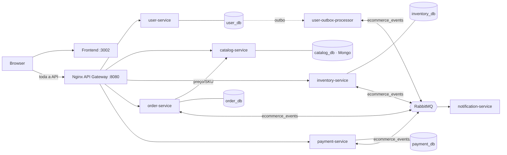

# MicroStore — Estudo de caso de microsserviços orientados a eventos 🛒⚡

[](https://github.com/luxuz24/meu-ecommerce-distribuido/actions/workflows/ci.yml)


Um e-commerce dividido em **5 microsserviços com banco próprio**, que fecham uma compra por uma
**Saga coreografada** sobre RabbitMQ, sem chamadas HTTP em cadeia e sem transação distribuída.

O objetivo é mostrar, rodando e testado, como resolver os problemas que aparecem quando um
monólito vira um sistema distribuído:

- como gravar no banco **e** publicar um evento sem perder nenhum dos dois;
- como lidar com mensagens duplicadas;
- como desfazer uma reserva quando o pagamento falha;
- como impedir que dois pedidos simultâneos vendam a mesma unidade;
- como seguir uma única compra através de quatro serviços.

Cada uma dessas garantias tem um teste ponta a ponta que roda no CI contra a stack real.

---

## 🏛️ Arquitetura



| Serviço | Banco | Responsabilidade | Papel na Saga |
|---|---|---|---|
| **user-service** | Postgres `user_db` | Cadastro, login JWT (HS256), RBAC `CUSTOMER`/`ADMIN` | — |
| **catalog-service** | MongoDB `catalog_db` | Vitrine, busca textual, CRUD admin | Fonte de verdade do preço |
| **order-service** | Postgres `order_db` | Ciclo de vida do pedido `PENDING → STOCK_RESERVED → PAID / CANCELLED` | Inicia a Saga e aplica o desfecho |
| **inventory-service** | Postgres `inventory_db` | Reserva atômica, estorno e baixa definitiva | Participante + compensação |
| **payment-service** | Postgres `payment_db` | Cobrança simulada com regra antifraude | Participante |
| **notification-service** | — | Consome eventos e simula e-mails | Observador |

Somente o **gateway (`:8080`)** e o **frontend (`:3002`)** são expostos no host. Os serviços só
são alcançáveis pela rede interna, então rate limit, roteamento e rastreabilidade não podem ser
contornados.

## ⚡ A Saga de checkout

1. **`order-service`** recebe `{productId, quantity}`, busca preço, nome e SKU no catálogo,
   grava o pedido `PENDING` e o evento `ORDER_CREATED` na **outbox**, na mesma transação.
2. **`inventory-service`** reserva o estoque com um `UPDATE` condicional e publica
   `STOCK_RESERVED`. Se faltar saldo, publica `STOCK_REJECTED` e o pedido é cancelado sem cobrança.
3. **`payment-service`** cobra o total calculado pelo servidor e publica `PAYMENT_APPROVED` ou
   `PAYMENT_FAILED`.
4. **Desfecho:**
   - **aprovado:** o pedido vira `PAID` e a reserva vira baixa definitiva (`ORDER_CONFIRMED`);
   - **recusado:** o pedido vira `CANCELLED` e o inventory **estorna a reserva** (compensação).

O diagrama de sequência completo está em [docs/01-visao-e-arquitetura.md](./docs/01-visao-e-arquitetura.md#a-saga-de-checkout).

## 🛡️ Garantias e como são obtidas

| Problema | Solução | Prova |
|---|---|---|
| Gravar e publicar de forma atômica | **Transactional Outbox**, com relay que só marca `published` após o *publisher confirm* do broker | Teste de caos abaixo |
| Mensagens duplicadas (*at-least-once*) | Tabela `processed_messages` + transições de estado condicionais | Unitários + E2E |
| Dois pedidos disputando o mesmo item | `UPDATE … WHERE availableQty >= qty` + `CHECK (availableQty >= 0)` no banco | E2E: 12 pedidos simultâneos por 4 unidades → exatamente 4 pagos |
| Falha no meio da Saga | Compensação: `payment_failed` estorna a reserva | E2E |
| Cliente adulterando o preço | Preço resolvido no catalog-service; o que vem do cliente é descartado | Unitário + E2E |
| Broker fora do ar | Reconexão com backoff (1s → 30s) e topologia redeclarada; health `503` enquanto degradado | Teste de caos abaixo |
| Mensagem envenenada | Dead Letter Exchange + uma `*_dlq` por fila | — |
| Seguir uma compra entre serviços | `X-Correlation-ID`: gateway → outbox → propriedade AMQP → `AsyncLocalStorage` | E2E + `grep` nos logs |
| Escalada de privilégio | Cadastro público sempre cria `CUSTOMER`; o ADMIN é provisionado pelo servidor | E2E |

Os trade-offs de cada decisão (coreografia × orquestração, outbox por polling × CDC etc.) e as
limitações conhecidas estão em [docs/01](./docs/01-visao-e-arquitetura.md#decisões-arquiteturais-adrs-resumidos).

---

## 🚀 Rodando localmente

Pré-requisitos: **Docker** com Compose v2 e **Node.js 24+** (para os scripts de seed e E2E).

```bash
git clone https://github.com/luxuz24/meu-ecommerce-distribuido.git
cd meu-ecommerce-distribuido
cp .env.example .env

docker compose up -d --build --wait   # sobe 12 containers e espera todos os healthchecks
npm run seed:demo                     # admin, cliente e 5 produtos com estoque
```

| | URL | Credenciais |
|---|---|---|
| Loja | http://localhost:3002 | `cliente@microstore.com` / `ClientePassword123!` |
| Painel admin | http://localhost:3002/admin/products | `admin@microstore.com` / `AdminPassword123!` |
| Arquitetura interativa | http://localhost:3002/architecture | — |
| API Gateway | http://localhost:8080 | — |
| RabbitMQ Management | http://localhost:15672 | `guest` / `guest` |

## 🔬 Roteiro de demonstração

**1. Compra feliz.** Na loja, adicione um produto ao carrinho e finalize. O pedido nasce
`PENDING` e a tela acompanha sozinha até `PAID`, em cerca de 3s.

**2. Compensação.** Finalize outra compra marcando **"Simular Falha de Pagamento"**. O pedido
termina `CANCELLED` e o estoque volta ao valor original.

**3. Rastreabilidade.** Cada resposta traz um `X-Correlation-ID`, que aparece no inspetor de
telemetria do modo Dev. Com ele você vê a compra atravessar os serviços:

```bash
docker compose logs -t | grep <correlation-id>
```

```
order-service         POST /api/orders
inventory-service     [inventory-service] cid=… <- order_created
payment-service       [payment-service]   cid=… <- stock_reserved
order-service         [order-service]     cid=… <- payment_failed
inventory-service     [inventory-service] cid=… <- payment_failed   ← estorno
notification-service  Correlation: cid=…
```

**4. Caos: derrube o broker no meio do fluxo.**

```bash
docker stop ecom_rabbitmq
```

Faça uma compra: ela é aceita (`201 PENDING`) e o evento fica guardado na outbox. O endpoint
`/health/order` responde `503` com `"messaging":"disconnected"`.

```bash
docker start ecom_rabbitmq
```

Em poucos segundos os 5 serviços reconectam sozinhos e o pedido criado durante a queda conclui
como `PAID`, sem perder nenhum evento.

---

## 🧪 Testes

```bash
npm test           # 54 testes unitários (Vitest, fakes in-memory) em todos os serviços + frontend
npm run test:e2e   # 8 cenários ponta a ponta contra a stack em execução
```

Os cenários E2E ([`scripts/e2e-saga.ts`](./scripts/e2e-saga.ts)) passam só pelo gateway e criam
os próprios produtos, então podem rodar repetidamente:

| Cenário | Verifica |
|---|---|
| Caminho feliz | `PAID`, valor cobrado = total do servidor, reserva convertida em baixa |
| Compensação | Pagamento recusado → `CANCELLED` e estoque integralmente estornado |
| Falta de estoque | `STOCK_REJECTED` → `CANCELLED`, nenhuma cobrança criada |
| Antifraude | Compra acima de R$ 50.000 recusada |
| Integridade de preço | Preço/nome/SKU enviados pelo cliente são ignorados |
| Concorrência | 12 pedidos simultâneos por 4 unidades → exatamente 4 pagos, estoque final 0 |
| Rastreabilidade | `X-Correlation-ID` do cliente preservado pelo gateway |
| Segurança | Cadastro com `role: ADMIN` vira `CUSTOMER`; cliente não força a Saga nem chama endpoints internos |

No **CI** (GitHub Actions), cada PR roda build e testes unitários de cada serviço e do frontend.
Em seguida sobe a stack completa do zero, executa o seed e roda a suíte E2E; se algo falhar, os
logs dos containers são anexados ao job.

## 📚 Documentação

| Documento | Conteúdo |
|---|---|
| [Visão e Arquitetura](./docs/01-visao-e-arquitetura.md) | Sequência da Saga, garantias, ADRs, limitações |
| [Contratos de API e Eventos](./docs/04-contratos-api-e-eventos.md) | Endpoints, autorização, eventos e payloads |
| [Convenções de Código](./docs/03-convencoes-de-codigo.md) | Clean Architecture e padrões do monorepo |
| [Fluxo, SOLID e Segurança](./docs/06-fluxo-solid-e-seguranca.md) | Processo de PR e checklist de segurança |

## 📄 Licença

Distribuído sob a licença MIT. Veja [`LICENSE`](./LICENSE).
