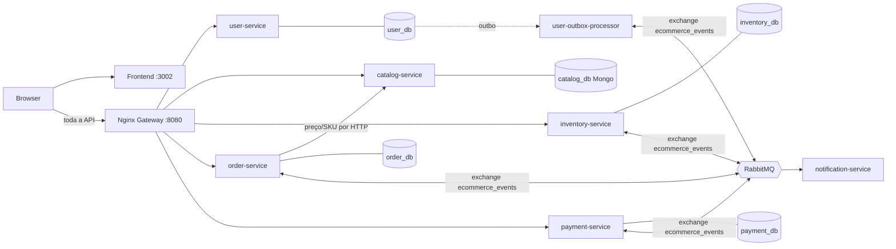
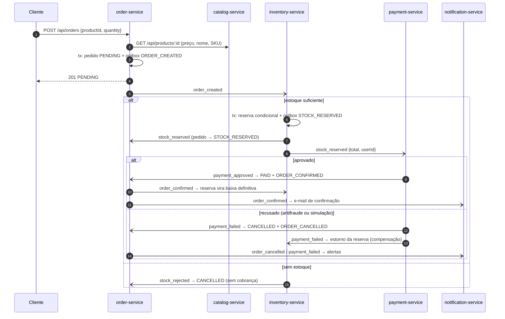

# 01 — Visão e Arquitetura

## O que é
E-commerce distribuído em microsserviços (Node 24, TypeScript ESM, Fastify) com persistência
poliglota (PostgreSQL + MongoDB) e uma **Saga coreografada** sobre RabbitMQ. Cada serviço tem
banco próprio e publica eventos exclusivamente via **Transactional Outbox**.

## Mapa do repositório
```
ecommerce_micro/
├── docker-compose.yml          # infra + serviços + gateway + frontend (com healthchecks)
├── gateway/nginx.conf          # API Gateway: roteamento, rate limit, X-Correlation-ID
├── init-scripts/               # cria os bancos lógicos no Postgres
├── scripts/
│   ├── seed-demo.ts            # dados de demonstração (via gateway)
│   └── e2e-saga.ts             # testes ponta a ponta da Saga (via gateway)
├── frontend/                   # React 19 + Vite + Tailwind
└── services/
    ├── user-service/           # cadastro, login JWT, RBAC            → Postgres user_db
    ├── user-outbox-processor/  # relay da outbox do user-service       → RabbitMQ
    ├── catalog-service/        # produtos, busca, CRUD admin           → MongoDB catalog_db
    ├── inventory-service/      # reserva/estorno/baixa de estoque      → Postgres inventory_db
    ├── order-service/          # ciclo de vida do pedido               → Postgres order_db
    ├── payment-service/        # cobrança simulada + antifraude        → Postgres payment_db
    └── notification-service/   # consome eventos e simula e-mails
```

## Topologia

Somente o gateway (`:8080`) e o frontend (`:3002`) são publicados no host; os serviços só são
alcançáveis pela rede interna do Compose.

## A Saga de checkout


## Garantias e como cada uma é obtida

| Problema distribuído | Mecanismo | Onde | Como está verificado |
|---|---|---|---|
| Gravar no banco e publicar o evento sem perder nenhum dos dois | Transactional Outbox + relay com **publisher confirms** | todos os serviços que publicam | E2E + teste de caos (broker parado, pedido conclui ao voltar) |
| Entrega *at-least-once* gera duplicatas | Tabela `processed_messages` + transições condicionais | consumers de inventory, order, payment | testes unitários + reentrega concorrente ao vivo |
| Duas reservas disputando o mesmo saldo | `UPDATE … WHERE availableQty >= qty` + `CHECK (availableQty >= 0)` | inventory-service | E2E: 12 pedidos simultâneos por 4 unidades |
| Falha no meio da Saga | Compensação: `payment_failed` estorna a reserva | inventory-service | E2E: cenário de pagamento recusado |
| Etapa que nunca responde (ex.: mensagem do pagamento na DLQ) | Reserva com prazo (`expiresAt`) + sweeper com transição condicional → `stock_reservation_expired` cancela o pedido | inventory + order | Teste de caos no CI (`scripts/chaos/reservation-expiry.sh`) |
| Cliente adulterando preço | Preço, nome e SKU resolvidos no catálogo | order-service | unitário + E2E |
| Broker indisponível no boot ou em produção | Reconexão com backoff (1s→30s) e redeclaração da topologia | `ResilientRabbit.ts` em cada serviço | cold start sem reinícios; teste de caos |
| Mensagem envenenada travando a fila | DLX `ecommerce_events_dlx` + filas `*_dlq` | todos os consumers | topologia declarada no código |
| Rastrear uma requisição entre serviços | `X-Correlation-ID` → coluna `outbox.correlationId` → propriedade AMQP → `AsyncLocalStorage` | gateway + serviços da Saga | E2E + `docker compose logs \| grep <cid>` |
| Escalada de privilégio | Cadastro público sempre `CUSTOMER`; ADMIN só via bootstrap no servidor | user-service | E2E: cenário de segurança |

## Decisões arquiteturais (ADRs resumidos)

**ADR-1 — Coreografia em vez de orquestração.** Não há um orquestrador central: cada serviço
reage a eventos e publica o próximo. Ganha-se baixo acoplamento e ausência de ponto único de
falha; perde-se a visão do fluxo em um só lugar. Mitigação: o diagrama acima e o
`X-Correlation-ID`, que reconstrói a jornada nos logs. Com mais etapas (frete, nota fiscal), a
orquestração passaria a compensar.

**ADR-2 — Outbox com polling (1s) em vez de CDC.** Polling é simples e não exige Debezium/Kafka
Connect; o custo é latência de até ~1s por salto e consultas periódicas ao banco. O
`user-outbox-processor` usa `FOR UPDATE SKIP LOCKED` para permitir réplicas; os relays embutidos
nos demais serviços contam com a idempotência dos consumers para absorver publicações duplicadas.

**ADR-3 — Preço consultado por HTTP síncrono ao catálogo.** É o único acoplamento síncrono entre
serviços e foi escolhido por ser a fonte de verdade do preço no momento da compra. Se o catálogo
cair, a criação de pedidos responde `503` (timeout de 3s), mas pedidos em andamento seguem pela
Saga. A alternativa seria uma réplica local de preços alimentada por eventos `product_updated`.

**ADR-4 — Módulo de mensageria replicado em vez de pacote compartilhado.** `ResilientRabbit.ts` é
copiado em cada serviço. Cada microsserviço tem build e deploy independentes (contexto Docker
próprio); um pacote interno acoplaria as versões de todos. O custo é manter as cópias iguais.

**ADR-5 — Reserva de estoque antes do pagamento.** Reservar primeiro evita cobrar por algo
indisponível; o custo é a reserva temporária, liberada na compensação ou convertida em baixa
definitiva no `order_confirmed` — e, se nenhuma das duas chegar, expirada pelo sweeper após `RESERVATION_TTL_SECONDS`.

## Limitações conhecidas (fora do escopo deste estudo de caso)
- Não há fluxo de estorno financeiro: se o pagamento for aprovado depois que a reserva expirou e
  o estoque já foi vendido a outro cliente, o inventory registra `PAID_ORDER_WITHOUT_STOCK` para
  intervenção manual em vez de emitir um reembolso automático.
- Mensagens na DLQ não são reprocessadas automaticamente; a expiração de reservas limita o dano,
  mas a reentrega exige ação operacional.
- Não há tracing distribuído com spans (OpenTelemetry/Jaeger); a rastreabilidade é por
  correlation id em logs.
- O JWT é validado em cada serviço com segredo compartilhado (HS256). Em produção, chaves
  assimétricas (RS256/JWKS) evitariam distribuir o segredo de assinatura.
- Pagamento é simulado; não há integração com gateway real.
